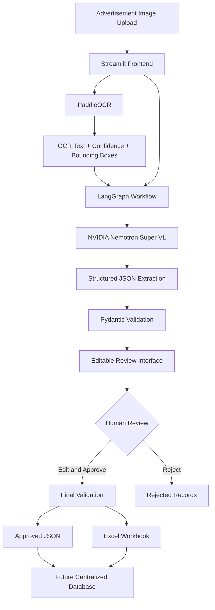

# AdStruct AI — AI-Powered Advertisement Data Extraction & Structuring System

**An end-to-end AI solution developed to streamline advertisement data entry workflows at Indycium.**

[](https://adstruct.streamlit.app/)
[](https://www.python.org/)
[](https://www.langchain.com/langgraph)
[](https://www.paddleocr.ai/)
[](https://docs.pydantic.dev/)

**Live Application:** https://adstruct.streamlit.app/  
**GitHub Repository:** https://github.com/rajhansbagri09/AdStruct

---

## 1. Overview

AdStruct AI is an AI-powered advertisement data extraction and structuring system designed to reduce repetitive manual data-entry work.

It converts advertisement images into structured, machine-readable information using OCR, Vision Language Models (VLMs), workflow orchestration, and schema validation.

The system allows users to upload an advertisement image, automatically extract its information, review and correct the extracted fields, and export the approved information in JSON and Excel formats.

Unlike a basic OCR application, AdStruct combines visual understanding, structured extraction, validation, and Human-in-the-Loop (HITL) review in one workflow.

## 2. The Real-World Problem at Indycium

Advertisement data is often presented in unstructured visual formats such as newspaper advertisements, promotional creatives, product advertisements, and marketing images.

Converting these advertisements into organized digital records can involve several repetitive steps:

- Opening and examining each advertisement image.
- Identifying brands, products, headlines, descriptions, prices, offers, and contact information.
- Extracting product specifications and other relevant details.
- Organizing the extracted information into predefined fields.
- Checking the information for missing, incorrect, or uncertain values.
- Entering the verified information into structured records or spreadsheets.

### Why is this challenging?

**1. Unstructured information**

Advertisement information is distributed across images, different layouts, fonts, and visual elements.

**2. Manual effort**

Reading and transferring information into structured fields repeatedly consumes time and human effort.

**3. Extraction errors**

Small text, complex layouts, OCR mistakes, and ambiguous content can lead to incorrect entries.

**4. Inconsistent data**

Different advertisements may present the same type of information in different formats.

**5. Quality assurance**

Extracted information needs to be checked before it becomes part of an organization's records.

### Our approach

AdStruct AI automates the initial extraction and structuring process while retaining human verification before approval.

The objective is to reduce repetitive data-entry work, improve consistency, and make advertisement information easier to review and export.

## 3. Solution

AdStruct follows an automated AI-assisted workflow:

1. Upload an advertisement image.
2. Extract visible text using PaddleOCR.
3. Pass the original image and OCR results to a Vision Language Model.
4. Generate structured advertisement information.
5. Validate the output using Pydantic.
6. Display the extracted information in an editable review interface.
7. Allow a human reviewer to edit, approve, or reject the result.
8. Export approved information into JSON and Excel.

The system does not treat every model-generated value as correct. Human review remains an essential part of the process.

## 4. Key Features

- **Advertisement image processing:** Supports JPG, JPEG, and PNG uploads.
- **OCR extraction:** Extracts text, confidence scores, and bounding boxes using PaddleOCR.
- **Visual understanding:** Uses NVIDIA Nemotron Super VL to interpret the advertisement image.
- **Structured extraction:** Extracts information into predefined fields.
- **Schema validation:** Uses Pydantic to validate the structure and required fields.
- **Human-in-the-Loop review:** Allows users to inspect and edit extracted information.
- **Approval and rejection:** Separates approved and rejected advertisement records.
- **JSON export:** Downloads approved structured data.
- **Excel export:** Generates a workbook with six organized worksheets.
- **Workflow orchestration:** Uses LangGraph to organize the extraction pipeline.
- **Observability:** Supports LangSmith tracing when configured.
- **Deployment:** Available through Streamlit Community Cloud and Docker-based local deployment.

## 5. System Architecture



*The centralized database is a planned future integration, not part of the currently implemented workflow.*

## 6. End-to-End Workflow

### Step 1 — Advertisement Upload

The user uploads an advertisement image through the Streamlit interface.

The application accepts common image formats such as JPG, JPEG, and PNG.

### Step 2 — OCR Processing with PaddleOCR

PaddleOCR extracts visible text from the advertisement.

The OCR output includes:

- Recognized text.
- Text recognition confidence scores.
- Bounding-box coordinates.

These results provide supporting information for the subsequent extraction process.

### Step 3 — Vision-Based Information Extraction

The original advertisement image and OCR output are passed to the selected Vision Language Model:

**NVIDIA Nemotron Super VL 120B**

Model identifier:

`nvidia/nemotron-3.5-super-vl-120b-a12b`

The model uses both visual information and OCR text to identify advertisement details and return structured JSON.

The original image remains the primary source of truth. OCR text acts as supporting evidence.

The extraction prompt instructs the model to:

- Use only information visible in the advertisement.
- Avoid inventing missing information.
- Prefer the image when OCR and visual information disagree.
- Preserve the meaning of the original advertisement.
- Identify missing and uncertain fields.
- Return structured JSON rather than explanatory text.

### Step 4 — LangGraph Workflow Orchestration

LangGraph manages the processing pipeline through separate nodes.

| Node | Responsibility |
|---|---|
| OCR Node | Extracts text and supporting OCR information |
| Extraction Node | Uses the VLM to generate structured advertisement data |
| Validation Node | Checks the generated output against the Pydantic schema |

Workflow:

`START → OCR → Extraction → Validation → END`

This separation makes the workflow easier to understand, test, maintain, and extend.

### Step 5 — Pydantic Validation

The extracted JSON is validated against a predefined `AdvertisementSchema`.

The schema defines expected fields, data types, optional values, and required information.

This helps prevent malformed or incorrectly structured model responses from moving forward.

**Important:** Schema validation checks structural correctness, not whether every extracted fact is visually accurate. That is why human verification is still required.

### Step 6 — Human-in-the-Loop Review

The application displays the original advertisement alongside the extracted information.

The reviewer can:

- Inspect the extracted fields.
- Correct inaccurate values.
- Fill in missing information.
- Review uncertain information.
- Approve the advertisement.
- Reject the advertisement.

This approach combines AI automation with human judgment.

### Step 7 — Final Validation and Export

After approval, the edited data is validated again before export.

The system generates:

**JSON export**

A structured representation of the approved advertisement record.

**Excel export**

An organized workbook containing six worksheets:

1. Advertisement Details
2. Product Specifications
3. Clients & Offers
4. Contact Details
5. Location
6. Review Notes

Both exports are generated from the same approved data.

### Step 8 — Record Management

The current implementation maintains separate directories for uploaded, approved, and rejected images.

```text
outputs/
├── uploads/
├── approved/
└── rejected/
```

A centralized database and searchable advertisement archive are planned for a future phase.

## 7. Extracted Advertisement Fields

The system is designed to extract the following information:

| Field | Description |
|---|---|
| `ad_category` | Advertisement category |
| `ad_type` | Advertisement type |
| `client` | Associated clients |
| `brand` | Brand name |
| `headline` | Main advertisement headline |
| `description` | Advertisement description |
| `product_name` | Product or service name |
| `product_specification` | Product specifications |
| `price` | Displayed price |
| `offer` | Promotional offers |
| `contact` | Contact information |
| `location` | Address or location details |
| `missing_fields` | Fields not found in the advertisement |
| `uncertain_fields` | Fields requiring additional verification |

The schema supports optional information and collections of values to accommodate different advertisement layouts.

## 8. Model Evaluation and Selection

Selecting a suitable Vision Language Model was an important part of the development process.

Different models were tested with PaddleOCR across more than 50 advertisement examples.

The evaluation included multiple advertisement domains:

- Automobile
- Jewellery
- Healthcare
- Fashion
- Travel
- Real estate
- E-commerce

### Evaluation Journey

| Model / Configuration | Observation |
|---|---|
| Qwen2.5-VL + PaddleOCR | Initial baseline and strong early results |
| Qwen3.8-Instruct | Qwen2.5-VL performed better in the initial comparison |
| Other Ollama VLMs | Tested to compare extraction quality |
| Qwen3-VL | Required more processing time in observed tests |
| Nemotron 3.5 Bolt E4B via Ollama | Produced better results than the earlier Qwen2.5-VL baseline in subsequent testing |
| NVIDIA Nemotron Super VL 120B API | Selected final model based on observed extraction quality and response time |

### Final Model Selection

**OCR:** PaddleOCR 3.7.0

**Vision Language Model:** NVIDIA Nemotron Super VL 120B

The local Nemotron model through Ollama took approximately 2.5 minutes in an observed run, while the hosted NVIDIA Nemotron Super VL API took approximately 34 seconds.

These are observed timings, not results from a controlled performance benchmark.

The hosted model was selected after testing it on multiple advertisement examples.

No unsupported accuracy or precision score is claimed.

## 9. Technology Stack

| Component | Technology |
|---|---|
| Programming Language | Python 3.11 |
| Frontend | Streamlit |
| OCR | PaddleOCR |
| Vision Language Model | NVIDIA Nemotron Super VL 120B |
| Model API | NVIDIA AI Endpoints |
| Workflow Orchestration | LangGraph |
| Data Validation | Pydantic |
| Data Processing | Pandas |
| Excel Generation | OpenPyXL |
| Environment Configuration | Python-dotenv |
| Observability | LangSmith |
| Deployment | Streamlit Community Cloud, Docker |

## 10. Project Structure

```text
AdStruct/
│
├── Dataset/
│
├── Extract/
│   ├── backend/
│   │   ├── graph/
│   │   │   ├── state.py
│   │   │   ├── workflow.py
│   │   │   └── test_workflow.py
│   │   │
│   │   ├── nodes/
│   │   │   ├── extraction_node.py
│   │   │   ├── ocr_node.py
│   │   │   └── validation_node.py
│   │   │
│   │   └── schemas/
│   │       └── advertisment.py
│   │
│   ├── peddleOCR.py
│   └── phone_extract.py
│
├── frontend/
│   └── app.py
│
├── outputs/
│   ├── uploads/
│   ├── approved/
│   └── rejected/
│
├── .env.example
├── .gitignore
├── .dockerignore
├── Dockerfile
├── docker-compose.yml
├── packages.txt
├── requirements.txt
└── README.md
```

## 11. Run Locally

### Prerequisites

- Python 3.11
- Git
- NVIDIA API key
- Docker Desktop (only for Docker deployment)

### Step 1 — Clone the Repository

```bash
git clone https://github.com/rajhansbagri09/AdStruct.git
cd AdStruct
```

### Step 2 — Create a Virtual Environment

Using Conda:

```bash
conda create -n adstruct python=3.11
conda activate adstruct
```

Or using Python:

```bash
python -m venv venv
```

Activate on Windows:

```powershell
venv\Scripts\activate
```

### Step 3 — Install Dependencies

```bash
pip install -r requirements.txt
```

### Step 4 — Configure Environment Variables

Create a `.env` file in the project root.

```env
NVIDIA_API_KEY=your_nvidia_api_key

LANGSMITH_TRACING=false
LANGSMITH_API_KEY=
LANGSMITH_PROJECT=advertisement-data-entry
```

Obtain your NVIDIA API key through the NVIDIA developer platform.

Never commit `.env` or expose API keys in source code.

### Step 5 — Run the Application

```bash
streamlit run frontend/app.py
```

Open:

`http://localhost:8501`

## 12. Docker Deployment

AdStruct can also be packaged into a Docker container for easier local setup.

The container runs the application, while the selected Nemotron model is accessed through the NVIDIA hosted API.

This means the container does not include the 120B model weights.

### Build and Run

Make sure Docker Desktop is running.

Create the `.env` file as described above, then execute:

```bash
docker compose up --build
```

Open:

`http://localhost:8501`

To stop the application:

```bash
docker compose down
```

To view logs:

```bash
docker compose logs -f
```

**Important:** Docker packages the application and its dependencies. NVIDIA API access is still required for hosted model inference.

## 13. Live Deployment

The application is deployed on Streamlit Community Cloud.

**Try AdStruct AI:** https://adstruct.streamlit.app/

The deployed application uses Streamlit Secrets for sensitive configuration. Local users should configure their own `.env` file.

## 14. Reliability and Human Review

Real-world advertisement extraction requires more than generating JSON.

AdStruct uses multiple layers to improve reliability:

| Layer | Purpose |
|---|---|
| OCR | Extracts visible text |
| Visual model | Understands advertisement context and layout |
| Prompt constraints | Reduces unsupported assumptions |
| Pydantic | Enforces expected data structure |
| Human review | Corrects extraction mistakes |
| Final validation | Checks edited data before export |

The system explicitly accounts for missing and uncertain fields.

This is important because an advertisement may not contain every expected field, and a model should not invent information to fill those gaps.

## 15. Current Limitations

AdStruct is a working proof of concept, not yet a complete production enterprise system.

Current limitations include:

- Extraction quality can vary depending on image resolution, layout, and text visibility.
- OCR can make mistakes with small, stylized, or low-quality text.
- VLM-generated values still require human verification.
- Hosted inference depends on NVIDIA API availability, credentials, and usage limits.
- A centralized database and searchable historical archive are not yet implemented.
- Large-scale concurrent processing and enterprise access controls require further development.

## 16. Future Improvements

The next phase focuses on making AdStruct more useful as an organizational data-management system.

### 1. Centralized Advertisement Database

After human approval, records can be stored in a centralized database.

This would allow the organization to:

- Maintain a searchable archive of advertisements.
- Retrieve previously processed records.
- Avoid repeatedly entering the same advertisement information.
- Search by brand, product, category, client, or date.
- Manage historical advertisement data.

### 2. Duplicate Detection

Introduce image similarity and structured-field comparison to identify advertisements that may already exist in the database.

### 3. Search and Retrieval

Build a search interface to retrieve historical advertisements and their extracted information.

### 4. Batch Processing

Support multiple advertisement uploads and processing jobs.

### 5. Production Readiness

Add authentication, role-based access, monitoring, database persistence, error handling, and scalable processing.

## 17. Project Impact

AdStruct demonstrates how OCR, Vision Language Models, structured validation, and human review can be combined to address a repetitive business workflow.

Its intended organizational value is to:

- Reduce manual information extraction.
- Standardize advertisement records.
- Improve the consistency of data entry.
- Make extracted information easier to review.
- Produce reusable JSON and Excel records.
- Establish a foundation for a centralized advertisement archive.

The actual time savings and accuracy improvements should be measured through a controlled comparison with the existing manual workflow before making quantified business-impact claims.

## 18. Author

**Rajhans Bagri**

Final-year B.Tech Computer Science and Engineering (Artificial Intelligence) student.

Interested in Generative AI, Agentic AI, LLM applications, and practical AI automation.

- **GitHub:** https://github.com/rajhansbagri09
- **LinkedIn:** https://www.linkedin.com/in/rajhansbagri09
- **Portfolio:** https://resumeportfolio.in/rajhans09

---

**AdStruct AI — Turning Advertisement Images into Structured, Reviewable Business Data.**